# WP Wordle

A lightweight, responsive WordPress plugin to embed a bilingual Wordle game (Italian & English) directly into your site, featuring daily challenges and unlimited practice mode.

## 🚀 Quick Installation

1. Copy the plugin directory to `/wp-content/plugins/wp-wordle`.
2. Go to WordPress Dashboard > **Plugins** > **Installed Plugins** and click **Activate**.

## 🎮 Shortcode Usage

Embed the game into any post, page, or widget block:

```text
[wp_wordle]
```

### Essential Parameters

| Parameter | Values | Default | Description |
| :--- | :--- | :--- | :--- |
| `theme` | theme slug | `"brutalist"` | Visual theme for the game UI |
| `lang` | `"it"` \| `"en"` | `"en"` | Vocabulary & game language |
| `mode` | `"daily"` \| `"practice"` | `"daily"` | Shared daily challenge or unlimited practice mode |

**Combined example:**
```text
[wp_wordle theme="gameboy" lang="it" mode="daily"]
```

### 🖼️ Theme Preview Gallery
- **60 Modular CSS Themes (loaded on-demand):**  

<table>
  <tr>
    <td align="center" width="25%" valign="top">
      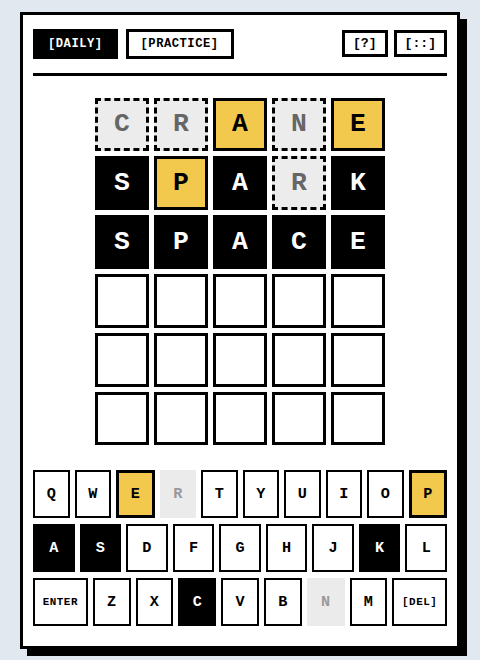<br/>
      <sub><b>Brutalist Monospace</b><br/><code>brutalist</code></sub>
    </td>
    <td align="center" width="25%" valign="top">
      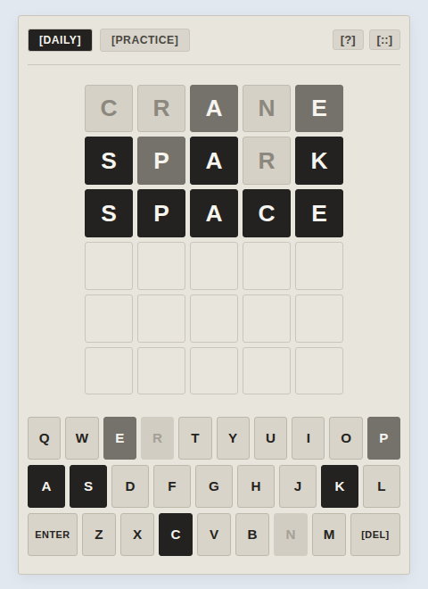<br/>
      <sub><b>E-Ink / Paperwhite</b><br/><code>eink</code></sub>
    </td>
    <td align="center" width="25%" valign="top">
      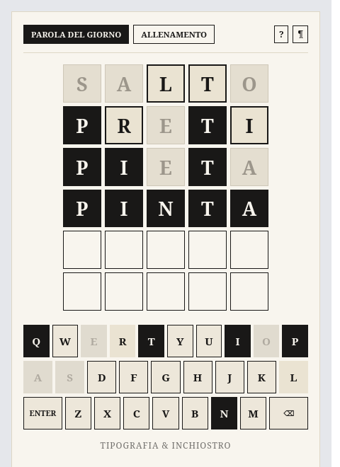<br/>
      <sub><b>Tipografia & Inchiostro</b><br/><code>editorial</code></sub>
    </td>
    <td align="center" width="25%" valign="top">
      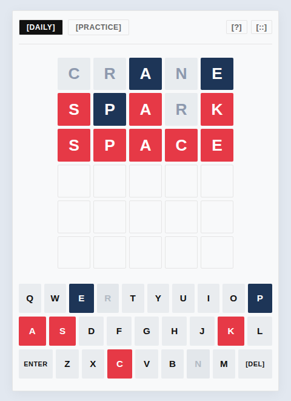<br/>
      <sub><b>Swiss International Style</b><br/><code>swiss</code></sub>
    </td>
  </tr>
  <tr>
    <td align="center" width="25%" valign="top">
      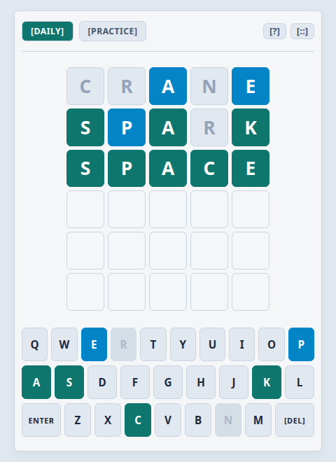<br/>
      <sub><b>Nordic Minimal</b><br/><code>nordic</code></sub>
    </td>
    <td align="center" width="25%" valign="top">
      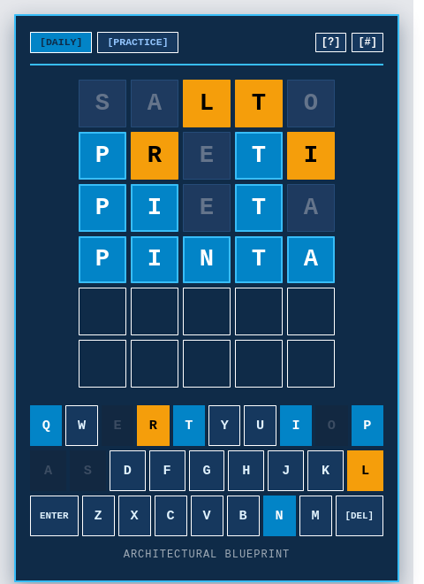<br/>
      <sub><b>Architectural Blueprint</b><br/><code>blueprint</code></sub>
    </td>
    <td align="center" width="25%" valign="top">
      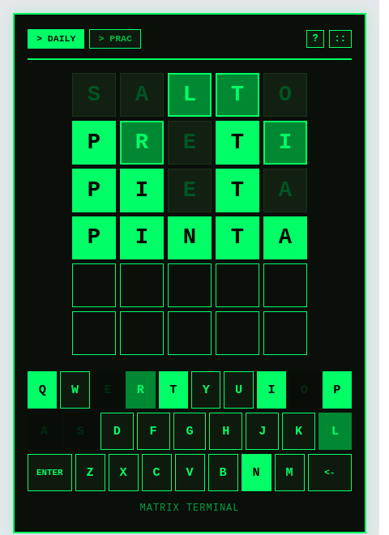<br/>
      <sub><b>Matrix Terminal</b><br/><code>matrix</code></sub>
    </td>
    <td align="center" width="25%" valign="top">
      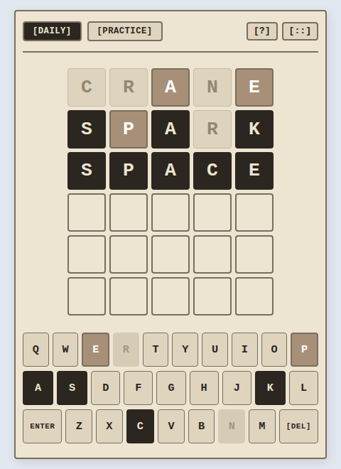<br/>
      <sub><b>Antique Typewriter</b><br/><code>typewriter</code></sub>
    </td>
  </tr>
  <tr>
    <td align="center" width="25%" valign="top">
      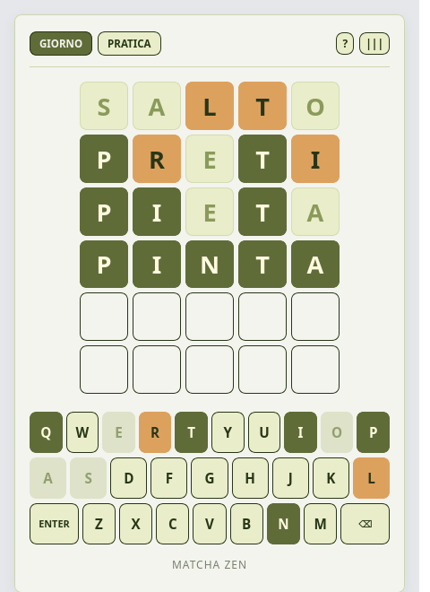<br/>
      <sub><b>Matcha Zen</b><br/><code>matcha</code></sub>
    </td>
    <td align="center" width="25%" valign="top">
      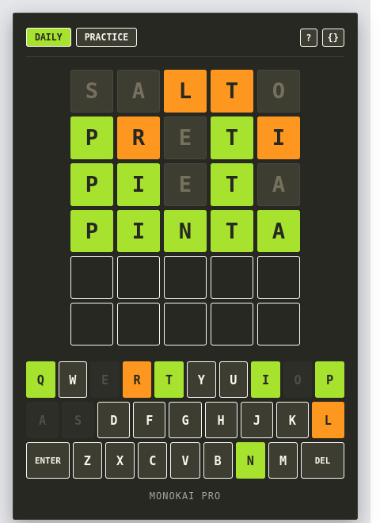<br/>
      <sub><b>Monokai Pro</b><br/><code>monokai</code></sub>
    </td>
    <td align="center" width="25%" valign="top">
      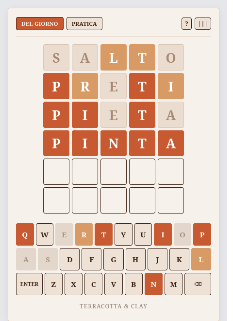<br/>
      <sub><b>Terracotta & Clay</b><br/><code>terracotta</code></sub>
    </td>
    <td align="center" width="25%" valign="top">
      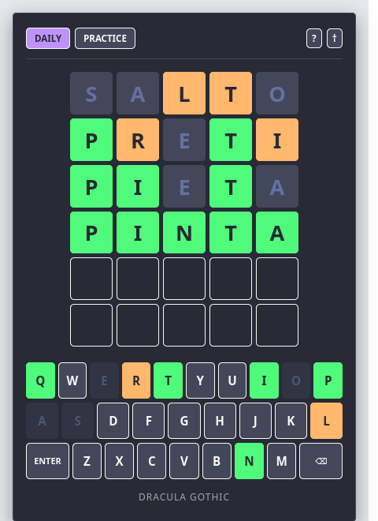<br/>
      <sub><b>Dracula Gothic</b><br/><code>dracula</code></sub>
    </td>
  </tr>
  <tr>
    <td align="center" width="25%" valign="top">
      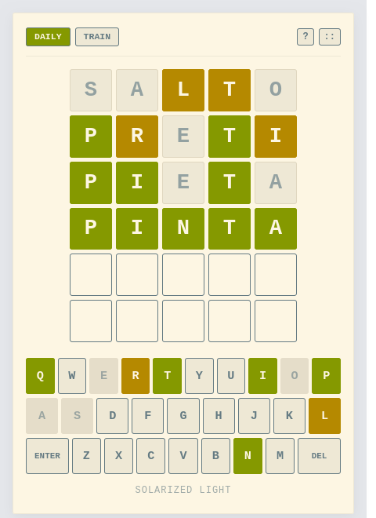<br/>
      <sub><b>Solarized Light</b><br/><code>solarized-light</code></sub>
    </td>
    <td align="center" width="25%" valign="top">
      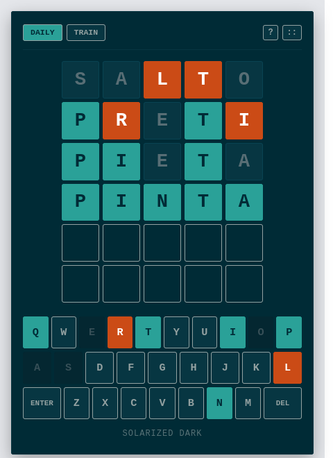<br/>
      <sub><b>Solarized Dark</b><br/><code>solarized-dark</code></sub>
    </td>
    <td align="center" width="25%" valign="top">
      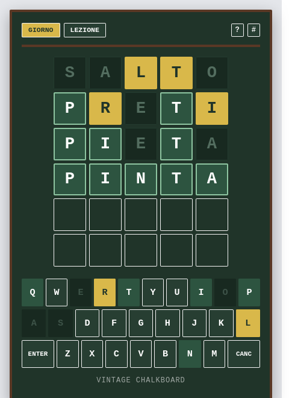<br/>
      <sub><b>Vintage Chalkboard</b><br/><code>chalkboard</code></sub>
    </td>
    <td align="center" width="25%" valign="top">
      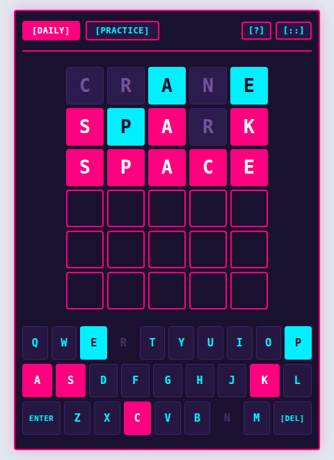<br/>
      <sub><b>Synthwave 80s</b><br/><code>synthwave</code></sub>
    </td>
  </tr>
  <tr>
    <td align="center" width="25%" valign="top">
      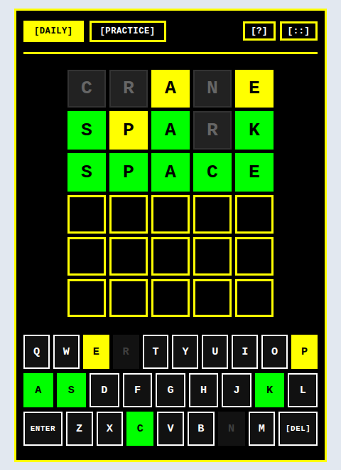<br/>
      <sub><b>Teletext / Ceefax</b><br/><code>teletext</code></sub>
    </td>
    <td align="center" width="25%" valign="top">
      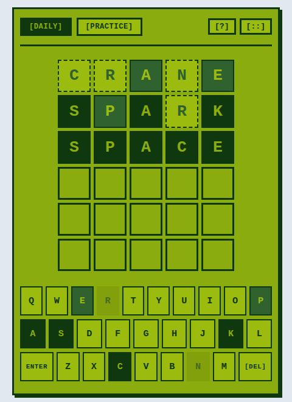<br/>
      <sub><b>Game Boy 1989</b><br/><code>gameboy</code></sub>
    </td>
    <td align="center" width="25%" valign="top">
      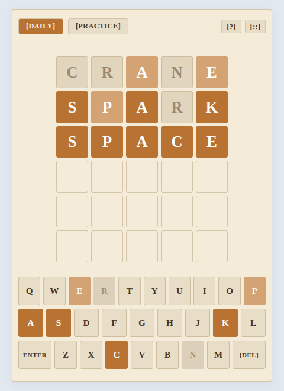<br/>
      <sub><b>Sahara Dune</b><br/><code>desert</code></sub>
    </td>
    <td align="center" width="25%" valign="top">
      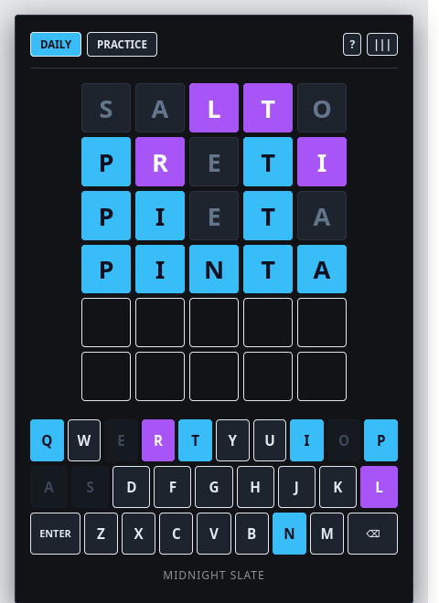<br/>
      <sub><b>Midnight Slate</b><br/><code>midnight-slate</code></sub>
    </td>
  </tr>
  <tr>
    <td align="center" width="25%" valign="top">
      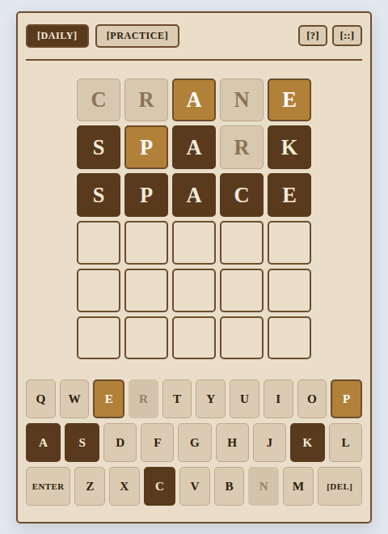<br/>
      <sub><b>Leather Journal</b><br/><code>leather</code></sub>
    </td>
    <td align="center" width="25%" valign="top">
      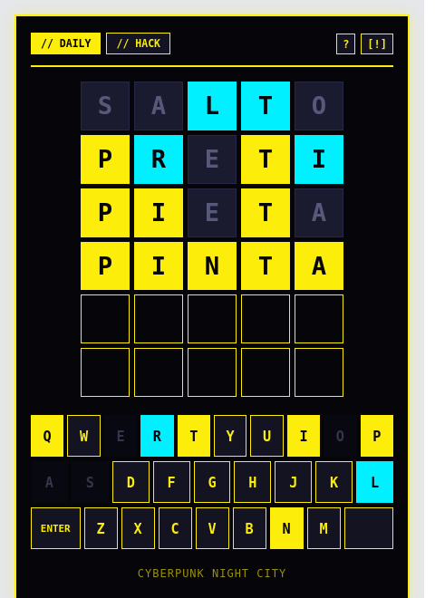<br/>
      <sub><b>Cyberpunk Night City</b><br/><code>cyberpunk</code></sub>
    </td>
    <td align="center" width="25%" valign="top">
      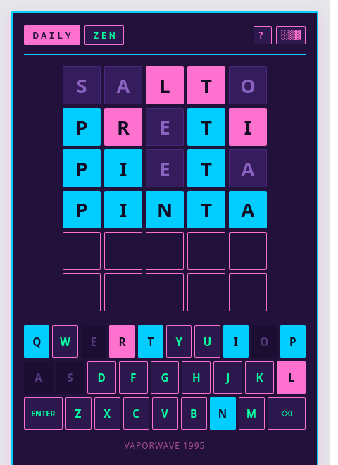<br/>
      <sub><b>Vaporwave 1995</b><br/><code>vaporwave</code></sub>
    </td>
    <td align="center" width="25%" valign="top">
      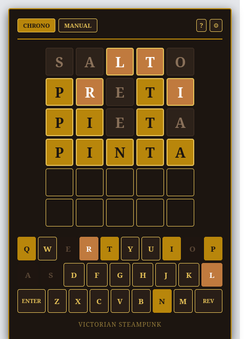<br/>
      <sub><b>Victorian Steampunk</b><br/><code>steampunk</code></sub>
    </td>
  </tr>
  <tr>
    <td align="center" width="25%" valign="top">
      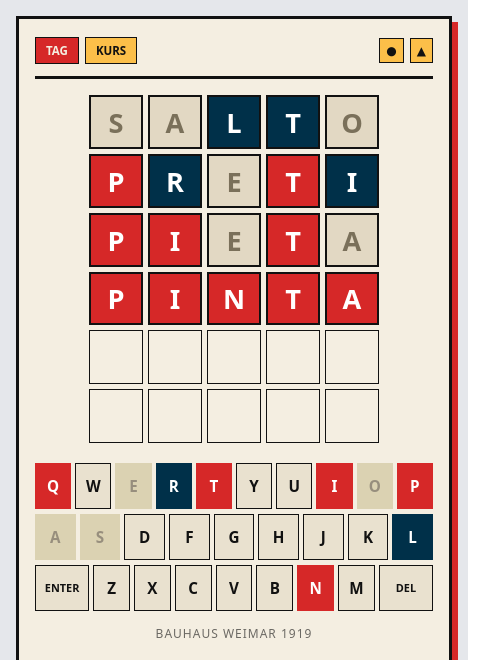<br/>
      <sub><b>Bauhaus Weimar 1919</b><br/><code>bauhaus</code></sub>
    </td>
    <td align="center" width="25%" valign="top">
      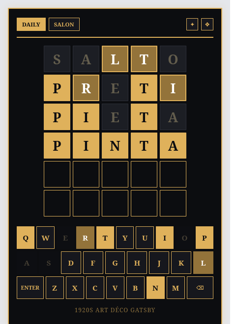<br/>
      <sub><b>1920s Art Déco Gatsby</b><br/><code>art-deco</code></sub>
    </td>
    <td align="center" width="25%" valign="top">
      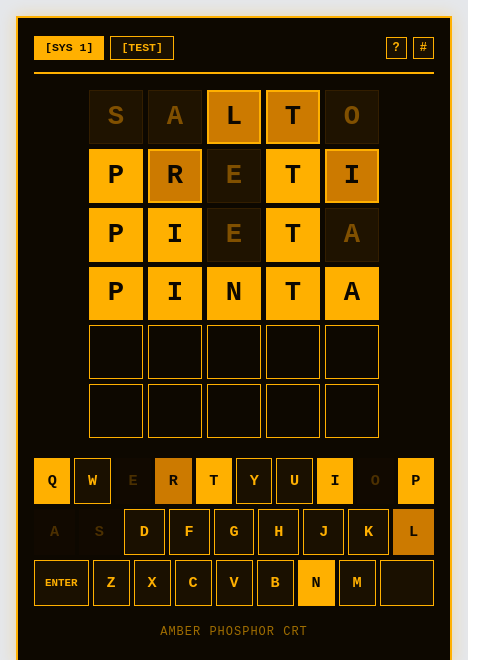<br/>
      <sub><b>Amber Phosphor CRT</b><br/><code>amber-crt</code></sub>
    </td>
    <td align="center" width="25%" valign="top">
      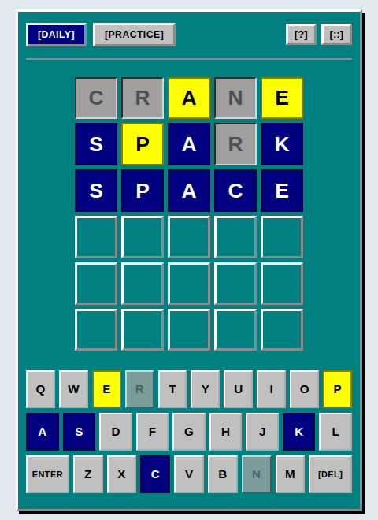<br/>
      <sub><b>Windows 95 Redmond</b><br/><code>win95</code></sub>
    </td>
  </tr>
  <tr>
    <td align="center" width="25%" valign="top">
      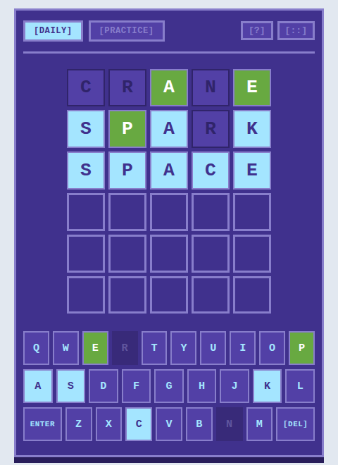<br/>
      <sub><b>Commodore 64 1982</b><br/><code>commodore64</code></sub>
    </td>
    <td align="center" width="25%" valign="top">
      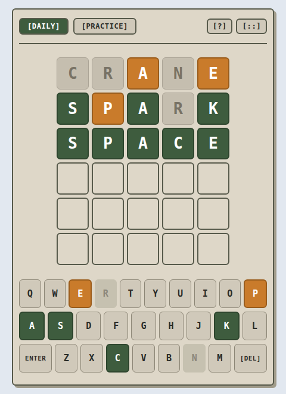<br/>
      <sub><b>Cassette Futurism</b><br/><code>cassette-futurism</code></sub>
    </td>
    <td align="center" width="25%" valign="top">
      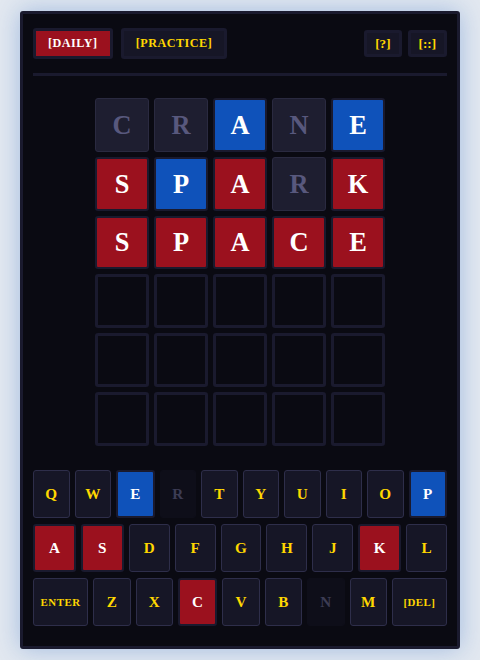<br/>
      <sub><b>Gothic Stained Glass</b><br/><code>stained-glass</code></sub>
    </td>
    <td align="center" width="25%" valign="top">
      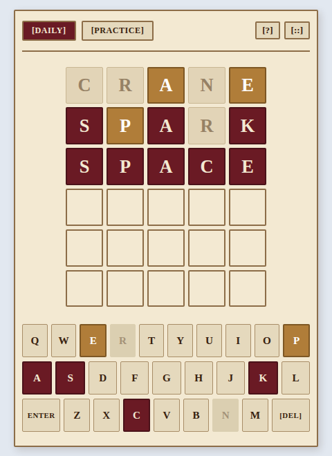<br/>
      <sub><b>Medieval Parchment</b><br/><code>parchment</code></sub>
    </td>
  </tr>
  <tr>
    <td align="center" width="25%" valign="top">
      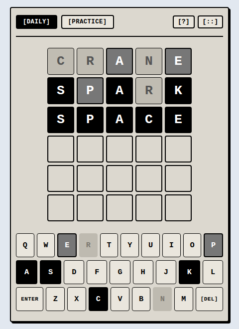<br/>
      <sub><b>Classic Mac OS 1984</b><br/><code>retro-mac</code></sub>
    </td>
    <td align="center" width="25%" valign="top">
      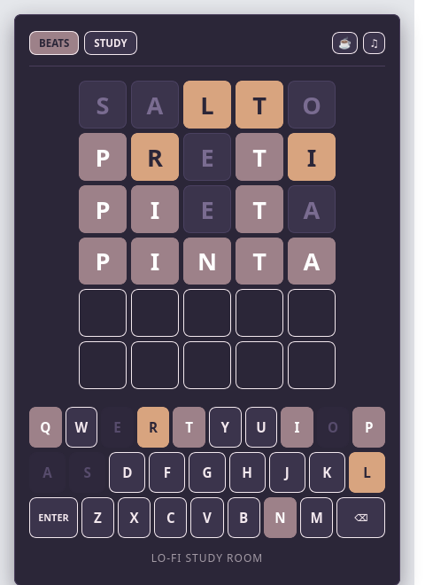<br/>
      <sub><b>Lo-Fi Study Room</b><br/><code>lofi-chill</code></sub>
    </td>
    <td align="center" width="25%" valign="top">
      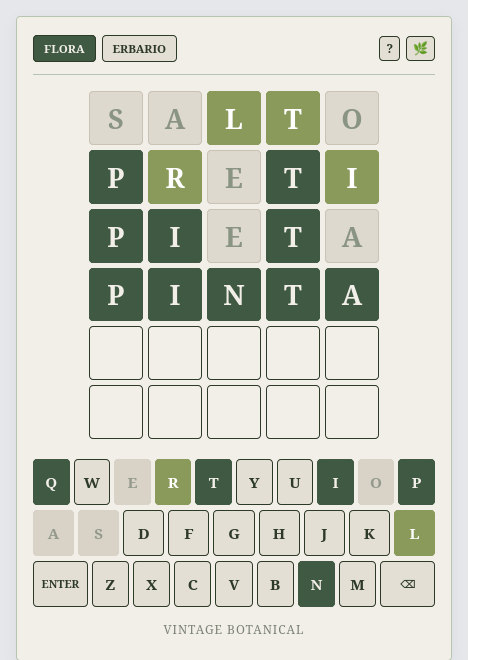<br/>
      <sub><b>Vintage Botanical</b><br/><code>botanical</code></sub>
    </td>
    <td align="center" width="25%" valign="top">
      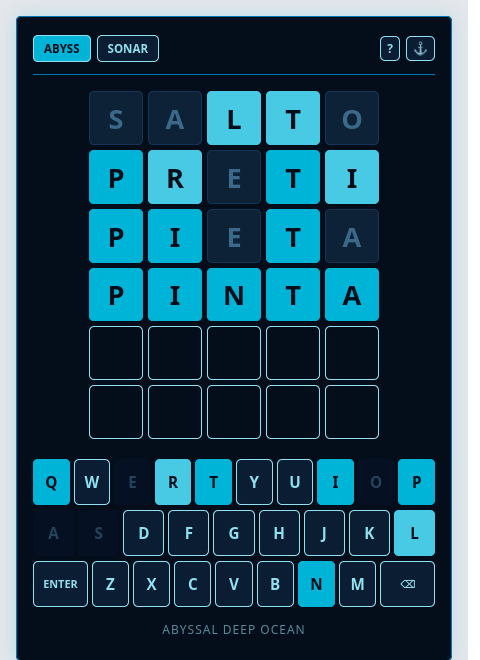<br/>
      <sub><b>Abyssal Deep Ocean</b><br/><code>deep-ocean</code></sub>
    </td>
  </tr>
  <tr>
    <td align="center" width="25%" valign="top">
      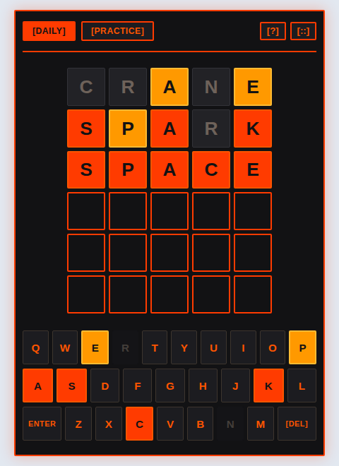<br/>
      <sub><b>Volcanic Obsidian</b><br/><code>volcanic</code></sub>
    </td>
    <td align="center" width="25%" valign="top">
      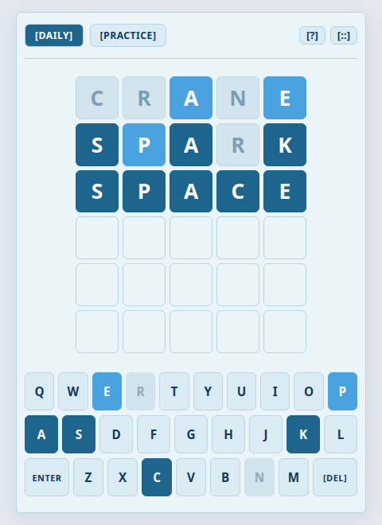<br/>
      <sub><b>Arctic Glacial Ice</b><br/><code>arctic</code></sub>
    </td>
    <td align="center" width="25%" valign="top">
      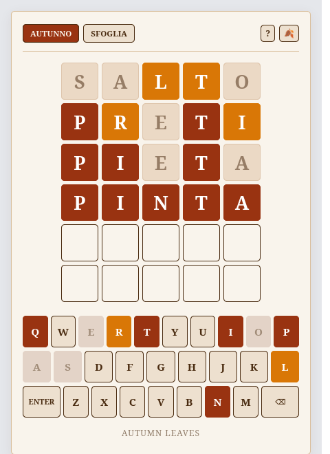<br/>
      <sub><b>Autumn Leaves</b><br/><code>autumn</code></sub>
    </td>
    <td align="center" width="25%" valign="top">
      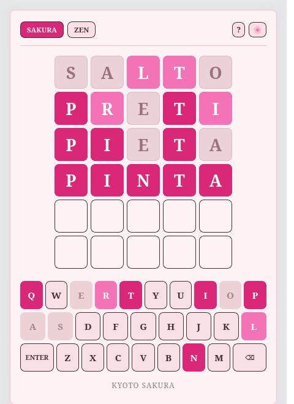<br/>
      <sub><b>Kyoto Sakura</b><br/><code>cherry-blossom</code></sub>
    </td>
  </tr>
  <tr>
    <td align="center" width="25%" valign="top">
      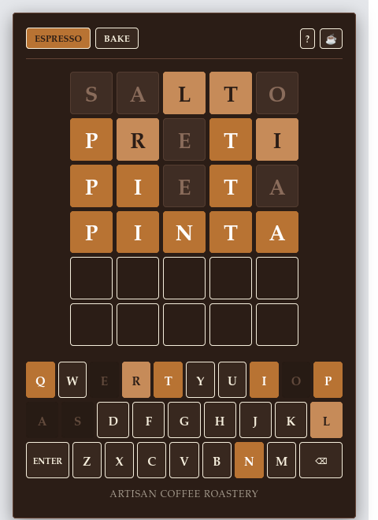<br/>
      <sub><b>Artisan Coffee Roastery</b><br/><code>coffee-roast</code></sub>
    </td>
    <td align="center" width="25%" valign="top">
      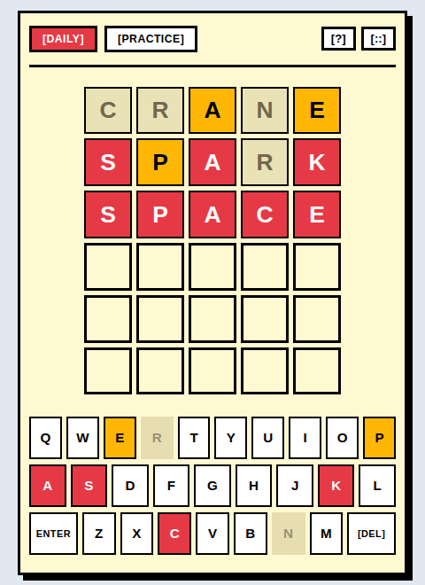<br/>
      <sub><b>Pop Art Comic Book</b><br/><code>comic-book</code></sub>
    </td>
    <td align="center" width="25%" valign="top">
      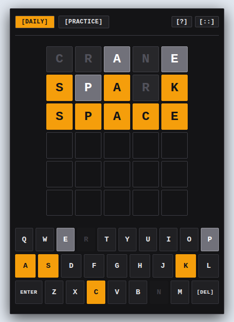<br/>
      <sub><b>Neo-Noir Detective</b><br/><code>neo-noir</code></sub>
    </td>
    <td align="center" width="25%" valign="top">
      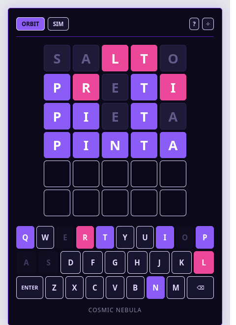<br/>
      <sub><b>Cosmic Nebula</b><br/><code>galaxy</code></sub>
    </td>
  </tr>
  <tr>
    <td align="center" width="25%" valign="top">
      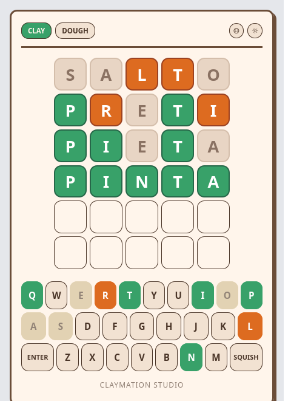<br/>
      <sub><b>Claymation Studio</b><br/><code>claymation</code></sub>
    </td>
    <td align="center" width="25%" valign="top">
      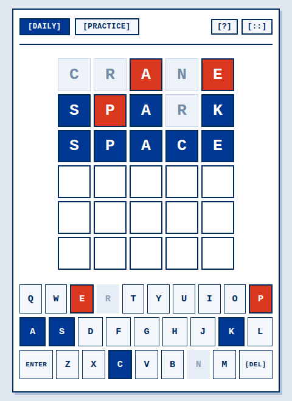<br/>
      <sub><b>Millimeter Graph Paper</b><br/><code>graph-paper</code></sub>
    </td>
    <td align="center" width="25%" valign="top">
      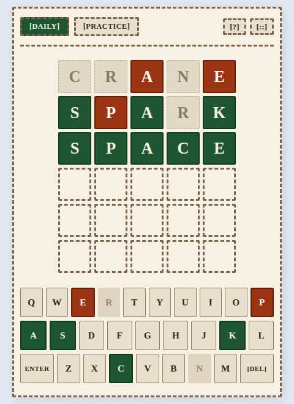<br/>
      <sub><b>Vintage Postage Stamp</b><br/><code>postage-stamp</code></sub>
    </td>
    <td align="center" width="25%" valign="top">
      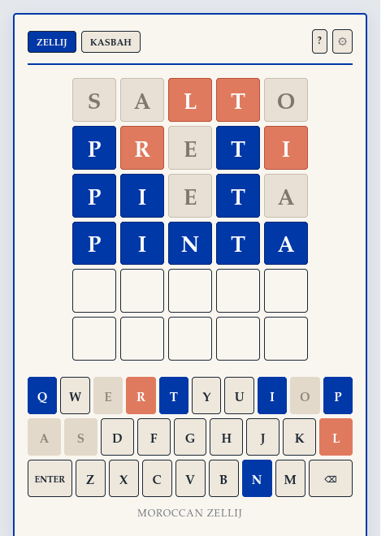<br/>
      <sub><b>Moroccan Zellij</b><br/><code>moroccan</code></sub>
    </td>
  </tr>
  <tr>
    <td align="center" width="25%" valign="top">
      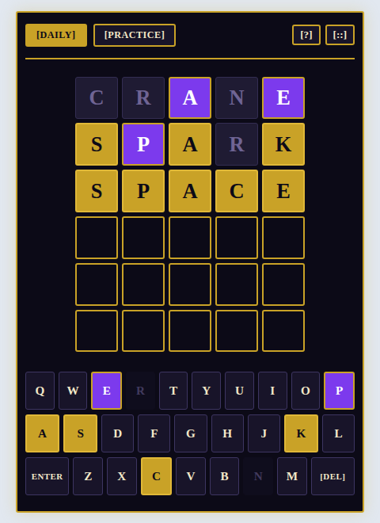<br/>
      <sub><b>Mystic Tarot</b><br/><code>tarot</code></sub>
    </td>
    <td align="center" width="25%" valign="top">
      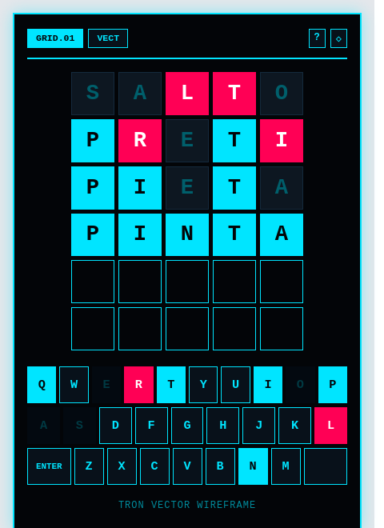<br/>
      <sub><b>Tron Vector Wireframe</b><br/><code>wireframe</code></sub>
    </td>
    <td align="center" width="25%" valign="top">
      <br/>
      <sub><b>Coin-Op Arcade 1984</b><br/><code>arcade-cabinet</code></sub>
    </td>
    <td align="center" width="25%" valign="top">
      <br/>
      <sub><b>Broadsheet Daily</b><br/><code>newspaper</code></sub>
    </td>
  </tr>
  <tr>
    <td align="center" width="25%" valign="top">
      <br/>
      <sub><b>Neon Tokyo Rain</b><br/><code>neon-tokyo</code></sub>
    </td>
    <td align="center" width="25%" valign="top">
      <br/>
      <sub><b>Radium Dial 1930</b><br/><code>radium</code></sub>
    </td>
    <td align="center" width="25%" valign="top">
      <br/>
      <sub><b>Washi Origami</b><br/><code>origami</code></sub>
    </td>
    <td align="center" width="25%" valign="top">
      <br/>
      <sub><b>Maritime Morse 1844</b><br/><code>morse-telegraph</code></sub>
    </td>
  </tr>
  <tr>
    <td align="center" width="25%" valign="top">
      <br/>
      <sub><b>Solar Flare Infrared</b><br/><code>solar-flare</code></sub>
    </td>
    <td align="center" width="25%" valign="top">
      <br/>
      <sub><b>VHS Tape Glitch</b><br/><code>glitch</code></sub>
    </td>
    <td align="center" width="25%" valign="top">
      <br/>
      <sub><b>Vintage Polaroid SX-70</b><br/><code>polaroid</code></sub>
    </td>
    <td align="center" width="25%" valign="top">
      <br/>
      <sub><b>Royal Baroque & Velvet</b><br/><code>baroque</code></sub>
    </td>
  </tr>
</table>

### 🔍 Vocabulary Validation & Anti-Spoiler Protection
- **Italian (IT):** Real-time verification against the official **Treccani** vocabulary with automatic local cache learning (`wp_wordle_learned_words_it`).
- **English (EN):** Built-in curated dictionary with dynamic fallback and learning via the Datamuse API (`wp_wordle_learned_words_en`).
- **Security & Anti-Spoiler:** Word evaluation is handled entirely server-side through the WordPress REST API; the secret solution is never leaked to the client browser prior to puzzle completion.

## ⚙️ Admin Dashboard Settings

Navigate to **Settings** > **WP Wordle** in the WordPress admin panel to:
- Select the global default theme for your site.
- Set the default game language (Italian / English).
- Manually override the daily secret word (for contests, promotions, or special events).
- Inspect dictionary caching status and check active solutions protected by spoiler toggles.

## 🧪 Automated Test Suite

The plugin comes with a comprehensive, modular automated test suite (137 assertions across 8 dedicated test suites) that verifies dictionary integrity, all 60 modular CSS themes, the game engine (IT & EN), live online dictionary services (Treccani & Datamuse), REST API controllers, frontend shortcode rendering, admin dashboard, and containerized Docker environment integration.

To run the complete test suite:
```bash
php tests/run-tests.php
```
*(or via legacy alias `php tests/test-all-plugin.php`)*

To run specific test modules (e.g. dictionary, engine, api, themes, docker):
```bash
php tests/run-tests.php dictionary
```
